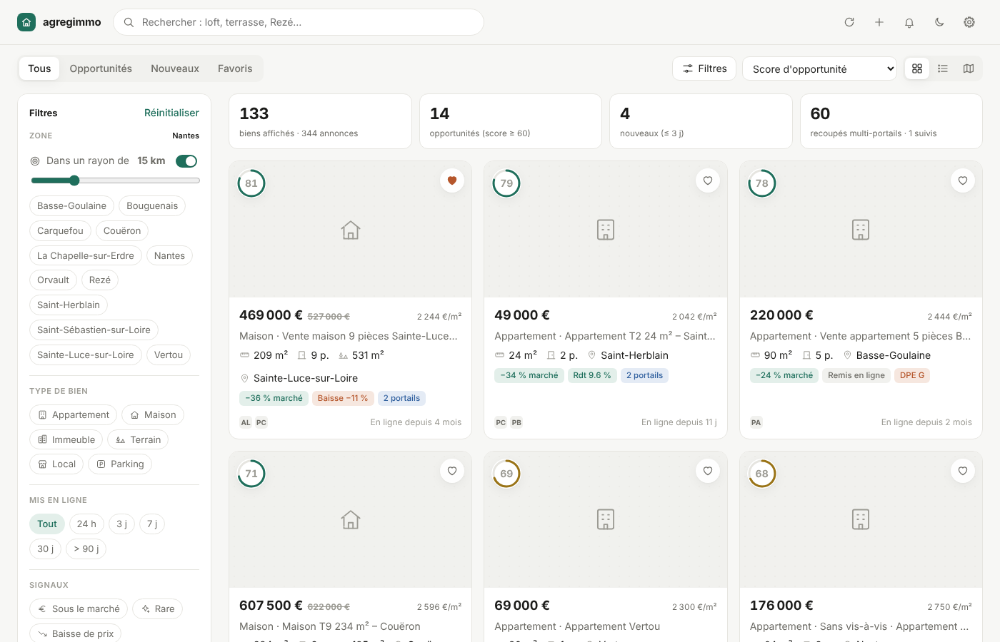

# agregimmo

Agrégateur d'annonces immobilières pour repérer **les biens rares et les opportunités d'investissement** dans une zone donnée.



## Sur téléphone (sans ordinateur)

L'application est publiée sur **https://elder83.github.io/agregimmo/** et s'installe comme une app :

- **iPhone (Safari)** : bouton Partager → « Sur l'écran d'accueil ».
- **Android (Chrome)** : menu ⋮ → « Installer l'application ».

Dans ce mode, tout tourne dans le téléphone : annonces, favoris et alertes sont stockés sur l'appareil, l'app s'ouvre même hors connexion et s'actualise à chaque ouverture. Pensez à *Paramètres → Données → Exporter* de temps en temps pour sauvegarder vos favoris.

Limite : un site ne se laisse lire depuis le navigateur que s'il l'autorise (CORS). Les flux RSS et la lecture automatique d'un lien échouent donc souvent sur téléphone ; collez alors le texte de l'annonce, ou utilisez le serveur ci-dessous.

**Publication** : chaque push sur `main` republie le site (`.github/workflows/pages.yml`). À activer une seule fois : *Settings → Pages → Source : GitHub Actions*.

### Version fichier unique

`npm run build` produit `dist/agregimmo.html` : toute l'application dans un seul fichier HTML, hébergeable n'importe où (c'est cette version qui est publiée comme page web privée). Dans ce mode, la capture par bookmarklet n'existe pas et la sauvegarde se fait par copier-coller.

## Sur ordinateur (serveur, optionnel)

Le serveur ajoute l'actualisation en tâche de fond et la lecture des flux RSS / pages sans restriction.

```bash
npm start            # http://localhost:3000  (Node ≥ 20, aucune dépendance)
npm test             # tests unitaires
PORT=8080 npm start  # autre port
```

Au premier lancement, un **marché de démonstration** (agglomération nantaise, 4 portails fictifs) est généré pour tout tester. De nouvelles annonces, baisses de prix et ventes y apparaissent au fil des jours. Désactivez-le dans *Paramètres → Sources* une fois vos vraies sources branchées.

## Fonctionnalités

| | |
|---|---|
| **Recoupement multi-portails** | Une même annonce diffusée sur plusieurs sites (ou republiée) est regroupée en un seul bien : type, pièces, surface (±4 %), prix (±8 %), DPE, distance et similarité du texte. Vous voyez chaque diffusion, son prix et l'écart éventuel entre portails. |
| **Vraie ancienneté** | La date de mise en ligne retenue est la plus ancienne de toutes les diffusions : une annonce « remise en ligne » pour paraître neuve est signalée. |
| **Score d'opportunité (0–100)** | Prix au m² vs médiane locale, rareté (mots-clés + surfaces hors norme), baisse de prix, rendement locatif brut estimé, durée en vente, levier DPE F/G. Chaque point est expliqué dans la fiche. Pondérations et mots-clés réglables. |
| **Zone** | Centre (recherche de commune via la Base Adresse Nationale) + rayon en km, filtre par communes, vue carte. |
| **Tri** | Score, récence, ancienneté, prix, prix/m², décote, baisse, rendement, surface, distance. |
| **Filtres** | Type, prix, prix/m², surface, pièces, date de mise en ligne (24 h → > 90 j), score minimum, signaux (sous le marché, rare, baisse, rendement ≥ 7 %, multi-portails, remis en ligne, DPE F/G). |
| **Favoris** | Cœur sur chaque bien, statut (suivi → à visiter → visité → offre → écarté), notes, alerte si le prix baisse après l'ajout. |
| **Alertes** | Enregistrez une recherche : badge des nouveautés, notifications du navigateur. Actualisation automatique côté serveur. |
| **Ajout manuel / capture** | Collez un lien ou un texte d'annonce : prix, surface, pièces, ville, DPE… sont extraits puis recoupés. Le **bookmarklet** (Paramètres → Sources) envoie la page en cours depuis n'importe quel site. |
| **Flux RSS / Atom** | Branchez les flux d'alertes de portails, agences, notaires. |
| **Import / export** | CSV (titre, prix, surface, pieces, ville, code postal, lien…) ou JSON ; export des favoris et réglages. |
| **Interface** | Épurée, icônes au trait, thème clair/sombre, grille / liste / carte, fenêtres modales, responsive mobile. Raccourci `/` pour rechercher. |

## Vraies annonces : alertes e-mail et portails

- **Bouton « Portails »** : ouvre Leboncoin, Bien'ici, SeLoger, PAP, Logic-Immo, notaires et enchères (Licitor), avec la recherche préremplie selon la zone et les filtres quand le portail le permet. Chaque lien peut être remplacé par l'adresse d'une recherche enregistrée sur le portail.
- **Alertes e-mail** : créez sur chaque portail une alerte envoyée à votre adresse Gmail. Chaque matin (6 h 32, heure de Paris), une tâche programmée lit ces e-mails et ajoute les annonces au fichier `annonces.json` de la branche `annonces`. L'application lit ce fichier à chaque actualisation (Paramètres → Sources → « Annonces reçues par alertes e-mail »). Ce fichier est public, comme le dépôt.

## Sources : ce qui est fait et ce qui ne l'est pas

Les grands portails interdisent l'aspiration automatique de leurs pages dans leurs CGU et la bloquent techniquement. agregimmo ne les « scrape » donc pas : il agrège ce que vous pouvez légitimement récupérer (flux RSS, exports, alertes, capture manuelle de la page que vous consultez, API partenaires). Pour ajouter une source, créez un module dans `public/core/` exposant `fetch({ settings })` qui renvoie des annonces au format :

```js
{ id, source, sourceLabel, url, title, description, type, price, surface, landSurface,
  rooms, bedrooms, dpe, city, postcode, lat, lng, photos, publishedAt }
```

puis déclarez-le dans `SOURCES` (`public/core/engine.js`).

## Architecture

```
public/
  core/         moteur commun au serveur et au téléphone
    engine.js   routes API, actualisation, ajout, import
    store.js    données (persistance injectée : fichier ou localStorage)
    dedup.js    recoupement des annonces en biens
    score.js    score d'opportunité et signaux
    parse.js    extraction de champs depuis texte / HTML
    geo.js      distances, géocodage (api-adresse.data.gouv.fr)
    demo.js     marché de démonstration
    feed.js     flux RSS / Atom
  local.js      mode autonome (moteur dans le navigateur)
  app.js …      interface (sans framework, Leaflet embarqué), PWA (manifest, sw.js)
server/index.js serveur HTTP optionnel (fichier data/db.json)
test/           tests node:test
```

## Pistes suivantes

- Prix de référence automatiques à partir des ventes réelles (DVF / data.gouv.fr).
- Bouton « ce n'est pas le même bien » pour corriger un regroupement.
- Comparaison de photos (hash perceptuel) pour un recoupement encore plus sûr.
- Envoi des alertes par e-mail ou Telegram.
